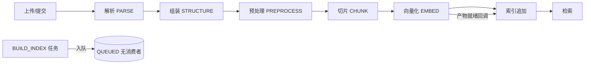

# 知识库流水线：总览与分册索引

> 本文件是 `.project/analysis/` 专题分析的总览，不是 `.project/archive/` 的 11 份项目档案。
> 结论基于源码静态审查（审查时点：2026-11-04），未启动服务、未运行测试；未运行时验证的判断标 `[推断]`。
> 各环节的详细问题、证据、取舍与验收在分册中展开；本文件只保留全链路结论、跨阶段根因与路线。

## 1. 结论摘要

1. 当前链路是“人工逐环节触发”的规则流水线：解析成功后停在终态，不自动触发组装；组装、预处理、切片、向量化都要人工逐次触发。`TaskRunnerSupport` 类注释明确写了“成功后停在终态，不自动触发下游”。
2. 解析层只做文本层抽取：PDF 走 PDFBox 几何规则，Office 走 POI 结构树；OCR / 版面 / 表格三个模型能力口全部返回 `null`（`CapabilityRegistryImpl`）。扫描件被直接判失败，图片只留编造的引用字符串，没有像素资产落盘。
3. 四个接线级缺陷让“语义检索”名存实亡：
   - 查询向量化从未接线：`SearchServiceImpl.embedQuery()` 恒返回 `null`，向量通道永远为空；
   - 父片默认不写向量库（`EmbedPipeline` 对 SECTION 片标 `SKIPPED`），默认检索规则却是 `PARENT_EXPAND`；
   - `BUILD_INDEX` 任务只入队、没有消费者（`PipelineTaskConsumer` 的扫库阶段与 dispatch 分支都不含它）；
   - 解析失败无法重跑：执行键唯一 + 已有任务任何状态拒绝 40431 + 同内容再次提交被判重复。
4. 配置与策略多处不可达或漂移：`docTemplate` 白名单允许 `{titlePath}`，但 `IdentityTemplate.render()` 直接返回 `chunk.content`；结构阈值只来自全局 yml，没有策略版本/快照；策略快照列只有 `varchar(1024)`，而自定义规则允许 20 条 × 200 字符。
5. 跨阶段契约不对齐，功能“静默失效”而不是报错：切片默认生成父片，向量化默认不向量化父片；表格可并入正文流但会丢 `tableRef`/单元格溯源；Excel sheet 是 `SECTION`，切片只认 `TITLE`；预处理默认 `MARK` 页眉页脚/目录/噪声，标记态文本仍进入切片。
6. 根因不是某个阈值调错，而是四层结构性缺口：能力层空壳（无资产、无模型）、数据契约只有“平铺文本+几何”（无角色/置信度/文档图）、任务模型是“一次性幂等作业”（无 attempt/重跑/自动编排）、验证体系只测单元行为（测试甚至固化缺陷）。

## 2. 端到端真实流程

| 环节     | 入口                                                                   | 产物                                                           | 是否自动进入下一环                            |
|----------|------------------------------------------------------------------------|----------------------------------------------------------------|-----------------------------------------------|
| 上传     | `/files` → `FileServiceImpl.upload`                                    | 对象存储文件 + 档案                                            | —                                             |
| 提交建档 | `KnowledgeBaseFileServiceImpl.submit`                                  | `wb_source_file` / `wb_file_result` / `wb_submit_log`          | 否，不建任务                                  |
| 解析     | `POST /file-results/{id}/parse` → `ParseTaskRunner`                    | `ParseResult` JSON                                             | 否                                            |
| 组装     | 指定 PARSE 产物 → `StructureTaskRunner`                                | `UnifiedDocument` JSON                                         | 否                                            |
| 预处理   | 指定 STRUCTURE 产物 → `PreprocessTaskRunner`                           | `PreprocessView` JSON                                          | 否                                            |
| 切片     | 指定 PREPROCESS 产物 → `ChunkTaskRunner`                               | `ChunkSet` JSON + `wb_chunk_set`/`wb_chunk`                    | 否                                            |
| 向量化   | 指定 CHUNK 产物 → `EmbedTaskRunner`                                    | `EmbeddingSet` JSON + `wb_embedding_set`/`wb_embedding_record` | 否（但会回调索引）                            |
| 索引     | `onFileProductsReady` 增量追加；`buildCandidate` 建 `BUILD_INDEX` 任务 | Milvus 集合 + 版本行                                           | 增量路径可自动 READY/发布；BUILD_INDEX 路径断 |
| 检索     | `POST /knowledge-base/{id}/search`                                     | 命中快照 `wb_retrieval_run`                                    | —                                             |

## 3. 分册索引

| 分册                                            | 覆盖环节                   | 主要内容                                                            |
|-------------------------------------------------|----------------------------|---------------------------------------------------------------------|
| [02-解析环节](02-解析环节.md)                   | PARSE                      | 解析器路由、PDF/Office 算法、质量门槛、错误分类、资产/OCR、D0/D1/D2 |
| [03-组装与预处理](03-组装与预处理.md)           | STRUCTURE / PREPROCESS     | 阅读顺序、跨页续表、标题层级、质量透传、预处理规则与默认动作        |
| [04-切片](04-切片.md)                           | CHUNK                      | token 估算、窗口切分、表格/图片、父子层级、章节边界、元数据         |
| [05-向量索引与检索](05-向量索引与检索.md)       | EMBED / BUILD_INDEX / 检索 | 查询向量、父片、模板、度量、索引一致性、rerank/评测                 |
| [06-编排状态与运维](06-编排状态与运维.md)       | 任务/状态/产物/运维        | 触发查重、消费、watchdog、补偿、上游门禁、重跑、迁移                |
| [09-PDF处理器重构设计](09-PDF处理器重构设计.md) | PARSE / PDF                | 分层步骤流水线、步骤契约、独立测试、行为不变保证                    |

## 4. 跨阶段根因

1. 能力层是“接口 + 空实现”，且契约里没有资产：OCR/版面/表格 provider 全返回 null；`OcrRegion`/`PageImage` 只有字符串引用，没有像素。
2. 解析契约只承载“文本 + 几何”，不承载语义：`ParseElement` 不产 TITLE/LIST/FIGURE_CAPTION，不产阅读顺序，不产文档图。
3. 质量语义被压扁：每环节一个状态 + 文案告警；失败页不隔离、PARTIAL 不带失败清单、下游不接收上游质量。
4. 任务模型是“一次性幂等作业”，不是“可重试流水线”：执行键唯一、无 attempt、无重跑、无自动下游。
5. 配置没有单一事实源：代码枚举、全局 yml、DB 策略 JSON、前端表单四套；默认值在触发时才补，版本语义漂移。
6. 跨阶段开关各自默认，缺少组合不变量：`parentChild` × `includeParent`、`tableInBodyFlow` × 表格身份、`SECTION` × 切片只认 TITLE、`MARK` × 切片跳过集。
7. 索引是 append-only 账本，不是可重建物化视图：无 delete/compaction、chunkId 是序号、READY 不等待全量对账、BUILD_INDEX 无消费者。
8. 验证体系只测现状：单测覆盖率高，但没有黄金文档集/端到端检索指标，测试甚至固化缺陷。

## 5. 问题解决边界

### A. 当前架构内没有路径，必须改契约/加能力

- 扫描 PDF / 图片文字：无资产、无 OCR；即使接 OCR，`evaluate()` 仍按 native 扫描页判死；
- 图片语义 / 图表内容：只有图片引用，无多模态向量；Milvus 只有单 `FloatVector`；
- 公式 / SmartArt / 脚注 / 参考文献：平铺元素模型，无公式 AST、注释锚点、文档图；
- 复杂多栏 / 图文绕排 / 嵌套栏：投影法只处理竖直栏沟 + 横跨行分带；结构阶段又用 bbox 二次猜；
- 单元格级页码 / bbox 高亮：cell 只有 row/col，没有 page/bbox；
- 语义切片：切片在向量化之前，chunking 无 Embedder/LLM 端口；DAG 顺序不允许；
- 同组合全量重建 / 删除收敛：索引 append-only，chunkId 是序号，无 delete；
- 量化评测：没有标注表、样本集、指标计算；
- 跨页复杂表格完美还原：规则只能靠表头/列宽/相邻性；
- 标题层级文档级一致：规则写死 level，无 outline/编号体系输入；
- 产物完全可复现：无代码版本/配置哈希。

### B. 纯工程接线缺口（已有骨架或外部服务，只差接上）

- 查询向量化、Rerank、OCR（灵犀已有接口）；
- `BUILD_INDEX` 消费、父片入索引、模板渲染、失败重跑、自动下游；
- 配置 fail-fast（D0-3 已落地）、快照列改 TEXT、MIME 别名归一（D0-4 已落地）、误报告警修正（D0-5 已落地）；
- 解析错误分类（D0-1 已落地）、OCR 结果消费（D0-2 门禁已落地，provider 待接入）、资产落盘。

### C. 需要数据/模型/标定

- 标题 / 页眉页脚 / 目录 / 版权页分类准确率；
- 无框线/跨页/合并单元格表格结构；
- 重复条款 vs 有意重复的语义区分；
- 切片长度/去重阈值/成功率门槛最优值；
- rerank/改写/加权是否值得引入（必须先有评测集）。

## 6. 优化路线

### P0：先让现有链路真正跑通、可重跑、可观测

1. 接通 `BUILD_INDEX` 消费：`PipelineTaskConsumer` 扫库阶段加 BUILD_INDEX，dispatch 加分支；补集成测试；修补偿器空转。
2. 接通查询向量化：`EmbeddingClient` 增加 `inputType`，检索侧真正调用；失败显式标记通道降级。
3. 修正父片链路：索引父片行，或父片展开改读 CHUNK 产物；校验 `parentChild`/`includeParent` 组合。
4. 给任务模型加重跑：任务表加 `attempt` 或新增重触发接口；允许 FAILED 任务生成新执行；区分“已有成功结果”和“仅有失败结果”。
5. 配置 fail-fast + 容量修复：`ParseProperties` 启动校验（D0-3 已落地）、`ChunkProperties`/`EmbedProperties` 待补；策略/产物快照列改 TEXT；MIME 路由别名归一（D0-4 已落地）；`ParseFact` 误报修正（D0-5 已落地）。
6. 索引一致性前置：READY 前全量对账；append/对账失败 → FAILED；加删除/按文档重建能力。

### P1：让解析有内容、有结构

7. 补资产链路：`AssetSink` + PDFRenderer/POI 图片字节落盘，`assetRef` 真 key。
8. 接 OCR：灵犀 `/ocr` + `StructuredOcrProvider`；扫描页 OCR 成功计可读，纯扫描件 PARTIAL。
9. 解析层补语义角色候选：标题/列表/图注事实，不改变“层级归组装”。
10. 修组装规则：保留解析器阅读顺序、排除 HEADER/FOOTER、续表跨页扫描、标题候选继续下探、层级归一化。
11. 修切片：tokenizer、窗口估算上界、表格长行/合并单元格、图片无文本不产占位片、父片上限、SECTION 章节边界。
12. 修预处理：页眉页脚/目录/噪声默认 EXCLUDE、文本整理按类型分档、EXCLUDE 粘性、视图补字段。

### P2：让质量可度量、可优化

13. 建立最小评测闭环：query → 相关 chunk → 相关性等级；Recall@k/MRR/nDCG@k/P95；接入 CI。
14. 评测通过后再接 rerank/改写/加权/阈值。
15. 策略与模型单一事实源：保存时固化完整配置 + 代码版本 + 哈希；结构环节策略化；模型目录从灵犀 catalog 拉取。
16. 架构级演进：索引不可变版本 + 删除/压缩 + 内容稳定 ID；文档图/多模态。

## 7. 证据与验证边界

- 本次是只读静态审查：逐文件阅读了解析、结构、预处理、切片、向量、索引、任务编排、灵犀网关及配置/DDL/种子策略；未启动服务、未跑测试。
- 关键结论可由源码定位：
  - 能力空壳：`workbuddy-server/workbuddy-worker/src/main/java/com/workbuddy/worker/parser/capability/impl/CapabilityRegistryImpl.java`；
  - 图片无资产：`workbuddy-server/workbuddy-worker/src/main/java/com/workbuddy/worker/parser/pdf/assemble/PdfImageEmitter.java`；
  - 扫描件判死：`workbuddy-server/workbuddy-worker/src/main/java/com/workbuddy/worker/parser/ParsePipeline.java`；
  - 失败不可重跑：`workbuddy-server/workbuddy-biz/src/main/java/com/workbuddy/biz/task/support/TaskTriggerSupport.java` + `workbuddy-server/workbuddy-biz/src/main/java/com/workbuddy/biz/service/impl/KnowledgeBaseFileServiceImpl.java`；
  - BUILD_INDEX 无消费者：`workbuddy-server/workbuddy-biz/src/main/java/com/workbuddy/biz/task/PipelineTaskConsumer.java` + `workbuddy-server/workbuddy-biz/src/main/java/com/workbuddy/biz/task/runner/IndexBuildTaskRunner.java`；
  - 查询向量未接线：`workbuddy-server/workbuddy-biz/src/main/java/com/workbuddy/biz/service/impl/SearchServiceImpl.java`；
  - 父片不入索引：`workbuddy-server/workbuddy-worker/src/main/java/com/workbuddy/worker/embedding/impl/EmbedPipeline.java` + `workbuddy-server/workbuddy-biz/src/main/java/com/workbuddy/biz/service/support/index/IndexRowSupport.java`；
  - 模板不可达：`workbuddy-server/workbuddy-worker/src/main/java/com/workbuddy/worker/embedding/impl/IdentityTemplate.java`；
  - 快照列 1024：`workbuddy-server/workbuddy-biz/src/main/resources/sql/init.sql`。
- 文中 `[推断]` 项（PDFBox 中断行为、Tika 别名出现概率、复杂版面错序的具体表现）未做运行时验证；其余为代码事实。
- 后续每个环节的改动都按仓库验证阶梯执行：单模块 `mvn -o -pl <模块> test`，跨模块加 `-amd`，推送前 `sh .agent/tools/common/pre-push-gate.sh`。
