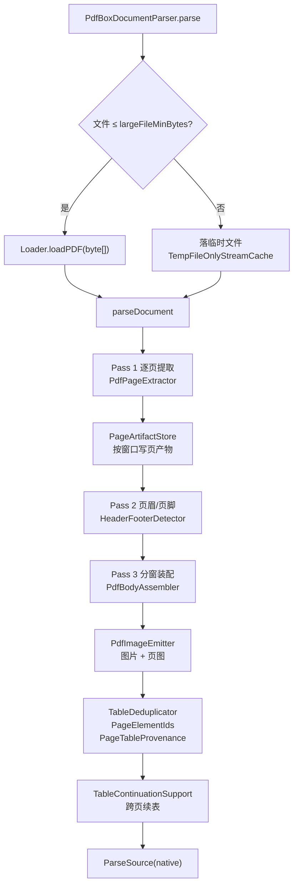
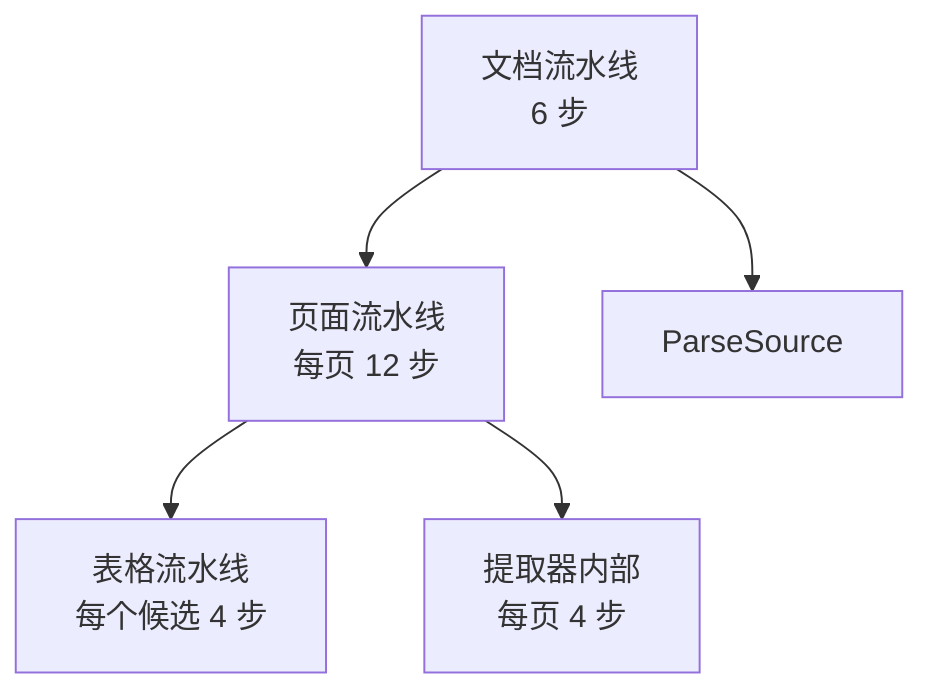
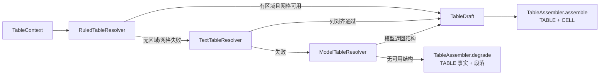
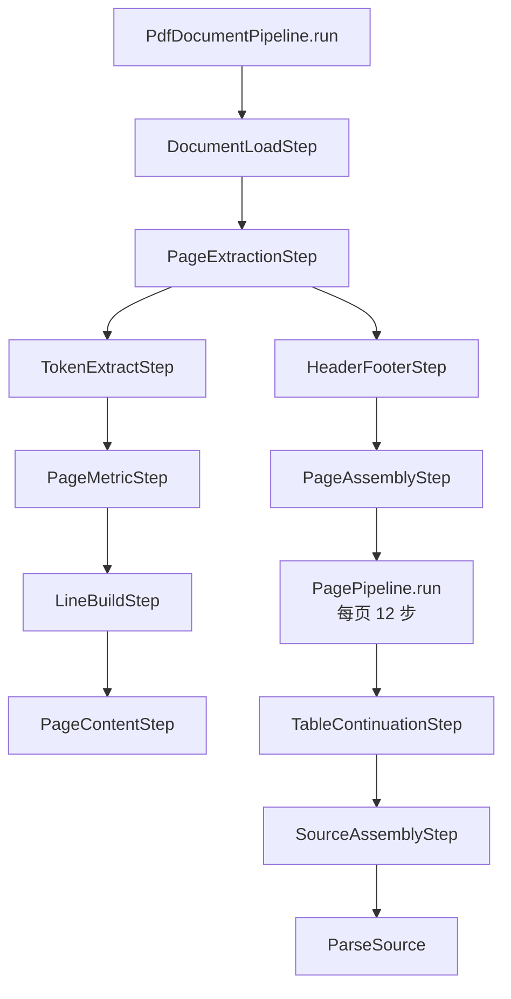
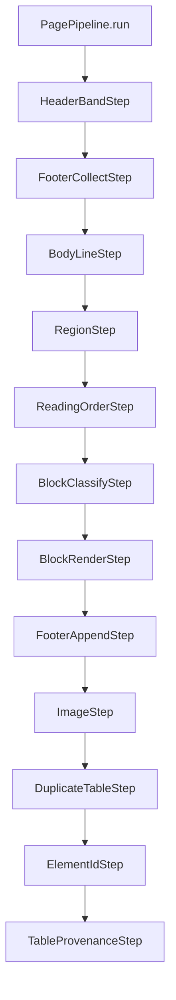
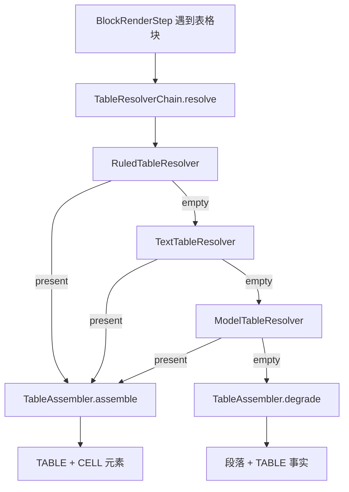
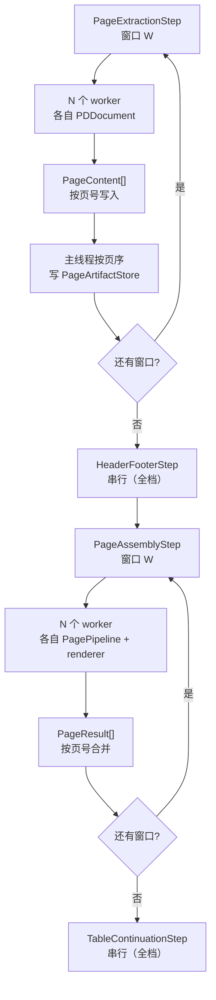

# PDF 处理器重构设计：分层步骤流水线（行为不变）

> 本文件回答：PDF 处理能不能拆成每一步都独立可测的流程、怎么拆、拆完怎么保证功能不变。
> 范围：`workbuddy-server/workbuddy-worker/src/main/java/com/workbuddy/worker/parser/pdf/`。不涉及解析环节其他部分（ParsePipeline、Office 解析、模型网关）。
> 结论：能。但不能把“每一步”理解成“每个方法”——步骤的粒度是“一个可独立断言的转换”。
> 本文是目标架构与实施方案；已实施范围与剩余决策见第 10 节。

**阅读指引**：只想快速判断可行性，读第 0、2 节；要评审契约，读第 3、4 节；要评估并发，读第 8 节；要动手实施，读第 6 节。

---

## 0. 先说结论

1. **能做到每步独立测试。** 每个步骤只依赖自己的输入契约，测试时 `new` 出来、喂 fixture、断言输出，不启动 Spring、不解析整份 PDF。
2. **“独立删除”要分两类。** 结构步骤（正文行、区域、块分类、渲染）删了会改变产物，不能随意删；可选能力步骤（模型版面、模型表格、OCR）可以替换为 no-op。用启动校验 + 黄金对拍兜底。
3. **目标架构是三层流水线**：文档流水线（6 步）→ 页面流水线（12 步）→ 表格流水线（4 步）；提取器内部再分 4 步。每层一个契约，不强行统一成一个万能 `Step` 接口。
4. **这次只改代码组织**：不改算法、阈值、产物、元素顺序、ID、溯源、事实顺序。行为不变靠单步契约测试 + 页面流水线测试 + 黄金样本对拍。
5. **上一版的问题**：把设计模式当主角，列了 7 个模式；`Template Method` 用得不准，后处理链与表格链重复，大上下文容易变成服务定位器。这一版以流水线为主角，模式只在自然出现时使用。
6. **页面并发可以，但不能直接 `parallelStream`**：PDFBox 的 `PDDocument`/`PDFRenderer` 非线程安全，必须每 worker 独立文档；采用“窗口内并行、窗口间串行”；CPU 用有界平台线程池，模型/资产 I/O 用虚拟线程；页面结果按页序合并。详见第 8 节。

| 你的诉求       | 能做到吗                 | 前提                                             |
|----------------|--------------------------|--------------------------------------------------|
| 每一步独立测试 | 能                       | 步骤只依赖自己的输入契约；fixture 不解析整份 PDF |
| 每一步独立替换 | 能                       | 实现同一个 `PageStep` / `TableResolver` 接口     |
| 每一步独立删除 | 结构步骤不能，可选步骤能 | 启动校验兜底依赖；黄金对拍兜底产物               |

**步骤粒度判定**：一个步骤必须同时满足——有独立输入/输出、有可独立断言的结果、不直接调用其他步骤的实现、删掉后能指出哪些测试会失败。四条缺一，就不拆。

---

## 1. 现状：为什么现在拆不动

### 1.1 当前主流程



### 1.2 三个硬耦合

| 耦合                         | 代码位置                           | 后果                                                                             |
|------------------------------|------------------------------------|----------------------------------------------------------------------------------|
| 一个类做完整页装配           | `PdfBodyAssembler.assemble` 423 行 | 页眉、页脚、区域、阅读顺序、段落、表格、降级全在一个方法族里；改一处要读半个文件 |
| 段落与表格候选共用一个状态机 | `PdfBodyAssembler.flushTextRun`    | 文本和表格无法独立测试；想单独验证表格候选，必须跑整页                           |
| 后处理写死在主流程           | `parseDocument` 里 4 个连续调用    | 新增去重/ID/溯源步骤必须改主流程；无法单独替换                                   |

### 1.3 现有测试的痛点

- 单测大多围绕 `PdfPageExtractor` 或整页装配，fixture 很大；
- 无法单独断言“这一页应该切成几个段落块、几个表格块”；
- 表格三条路径的测试要跨 `RuledTableBuilder`、`PdfBodyAssembler`、`TextTableBuilder` 三个类；
- 后处理只能整页验证，无法单独验证“去重后 ID 顺序”。

### 1.4 问题总表

| 编号 | 现象                  | 代码证据                                                                       | 影响                     |
|------|-----------------------|--------------------------------------------------------------------------------|--------------------------|
| P1   | 单页装配 423 行       | `PdfBodyAssembler.assemble`                                                    | 职责过多，读改都慢       |
| P2   | 表格回退跨 3 个类     | `RuledTableBuilder` → `flushTextRun` → `TextTableBuilder` → 模型               | 回退链隐式               |
| P3   | 方法 8–10 个参数      | `PdfBodyAssembler.assemble`                                                    | 调用处重复搬运同一组对象 |
| P4   | 元素构造重复          | 段落/表格/单元格/图片各写一遍 setter                                           | 字段口径容易漂移         |
| P5   | 聚类/并集多份实现     | `clusterEdges` / `RuleGrid.cluster` / `alignedPositions`；`union` / `boundsOf` | 改一处漏一处             |
| P6   | 后处理写死            | `parseDocument` 内 4 个调用                                                    | 加步骤要改主流程         |
| P7   | 单页提取 189 行       | `PdfPageExtractor.extractPage`                                                 | 指标/行构建/排序混在一起 |
| P8   | 渲染器 null 检查散落  | `PdfImageEmitter`、`TextTableBuilder`、`PdfBodyAssembler`                      | 主逻辑被判空淹没         |
| P9   | `RuleSegments` 365 行 | 采集、裁剪、连通分量、覆盖率一个类                                             | 内聚但偏大               |

结论：不是算法错，是**步骤边界**没有被显式表达。把边界画出来，每一步就能独立测试。

---

## 2. 目标架构：三层步骤流水线

### 2.1 总览



三层职责：

| 层         | 作用                                                                       | 为什么必须是这一层                    |
|------------|----------------------------------------------------------------------------|---------------------------------------|
| 文档流水线 | 加载、逐页提取、跨页页眉页脚、逐页装配、跨页续表、组装结果                 | 页眉/页脚和续表依赖全档，不能按页独立 |
| 页面流水线 | 一页内的页眉/页脚、正文行、区域、阅读顺序、块分类、段落/表格、图片、后处理 | 一页内的步骤可以完全独立测试          |
| 表格流水线 | 线框 → 文本 → 模型 → 降级组装                                              | 表格候选的三种识别路径可以独立测试    |
| 提取器内部 | token 提取、页指标、行构建、PageContent 组装                               | 把 PDFBox 依赖限制在第一步            |

### 2.2 文档流水线（6 步）

| 顺序 | 步骤                    | 输入                                        | 输出                                                   | 说明                                        |
|------|-------------------------|---------------------------------------------|--------------------------------------------------------|---------------------------------------------|
| 1    | `DocumentLoadStep`      | 输入流、配置、取消令牌                      | `LoadedPdf`（文档 + 临时文件 + 页数）                  | 小文件内存、大文件临时文件；`AutoCloseable` |
| 2    | `PageExtractionStep`    | `LoadedPdf`、配置                           | `ExtractedDocument`（页产物存储 + 页行 + 指标 + 尺寸） | 逐页调用提取器内部 4 步                     |
| 3    | `HeaderFooterStep`      | `List<PageLines>`、配置                     | `HeaderFooterKeys`（页眉键、页脚键）                   | 跨页识别，必须先于页面装配                  |
| 4    | `PageAssemblyStep`      | `ExtractedDocument`、键、配置、能力、资产口 | `PageAssemblyResult`（元素 + 事实 + 能力）             | 逐页跑页面流水线；只做编排，不做业务        |
| 5    | `TableContinuationStep` | 全部元素、重叠比例                          | 标记后的元素                                           | 跨页续表，必须最后做                        |
| 6    | `SourceAssemblyStep`    | 所有中间结果                                | `ParseSource`                                          | 只组装，不做解析                            |

文档流水线用**显式构造器注入**，不用 `@Order` 魔法。顺序写在一个地方，读代码不用跳。

### 2.3 页面流水线（12 步）

| 顺序 | 步骤                  | 输入（读取）              | 输出（写入）                               | 可独立测试的断言                     |
|------|-----------------------|---------------------------|--------------------------------------------|--------------------------------------|
| 1    | `HeaderBandStep`      | 页行、页眉键、页高        | `elements` 追加 HEADER                     | 页眉带内命中几行、文本/bbox 对不对   |
| 2    | `FooterCollectStep`   | 页行、页脚键、页高        | `footerElements`                           | 页脚带内命中几行、页码模式           |
| 3    | `BodyLineStep`        | 页行、页眉/页脚键         | `bodyLines`                                | 排除了哪些行、顺序是否保持           |
| 4    | `RegionStep`          | `page.segments`、配置     | `regions`、`regionLines`                   | 区域数量、每区域归属行               |
| 5    | `ReadingOrderStep`    | `bodyLines`、版面能力     | `orderedLines`                             | 无能力时顺序不变；有能力时按模型顺序 |
| 6    | `BlockClassifyStep`   | `orderedLines`、`regions` | `blocks`（有序：段落块/表格块/区域表格块） | 块数量、块类型、块边界               |
| 7    | `BlockRenderStep`     | `blocks`、页、配置        | `elements` 追加段落/表格                   | 每个块产出几个元素、顺序             |
| 8    | `FooterAppendStep`    | `footerElements`          | `elements` 追加 FOOTER                     | 页脚在正文之后                       |
| 9    | `ImageStep`           | 页、元素、渲染器、资产口  | `elements` 追加 IMAGE、资产                | 面积门槛、页图条件、顺序             |
| 10   | `DuplicateTableStep`  | 本页元素                  | 合并重复表                                 | 同 bbox 合并、保留非空格最多         |
| 11   | `ElementIdStep`       | 本页元素                  | 分配 ID                                    | ID 格式与顺序                        |
| 12   | `TableProvenanceStep` | 本页元素、文件 ID         | 表格/单元格溯源                            | 溯源路径格式                         |

注意：页面流水线只操作**本页局部**的 `elements`，不直接碰 `ParseSource`。这样测试不需要构造整份解析结果。

### 2.4 提取器内部（4 步）

| 顺序 | 步骤               | 输入                                     | 输出             | 说明                                           |
|------|--------------------|------------------------------------------|------------------|------------------------------------------------|
| 1    | `TokenExtractStep` | `PDDocument`、页号                       | `StrippedPage`   | PDFBox 依赖只在这里                            |
| 2    | `PageMetricStep`   | `StrippedPage`                           | `PageMetric`     | 字符数/乱码率/CID/图片/矢量                    |
| 3    | `LineBuildStep`    | `StrippedPage`、页几何、配置、版面分析器 | `List<PageLine>` | 栏沟、行带、切行、碎片合并、栏沟复核、阅读顺序 |
| 4    | `PageContentStep`  | 页号、几何、指标、行、线段、图片框       | `PageContent`    | 只组装，不算                                   |

`LineBuildStep` 仍然偏大，但它是一个**可独立测试的转换**：喂 `StrippedPage`，断言行数、行文本、阅读顺序。如果测试发现某一段（如栏沟复核）需要单独覆盖，再从 `LineBuildStep` 内部拆出子步骤；不为了拆而拆。

### 2.5 表格流水线（4 步）

| 顺序 | 步骤                 | 输入                             | 输出                                          | 说明                                                    |
|------|----------------------|----------------------------------|-----------------------------------------------|---------------------------------------------------------|
| 1    | `RuledTableResolver` | `TableContext`（有区域、有网格） | `TableResolution`（`TableDraft` + 事实/能力） | 线框表                                                  |
| 2    | `TextTableResolver`  | `TableContext`                   | `TableResolution`                             | 无框/线框失败后                                         |
| 3    | `ModelTableResolver` | `TableContext`                   | `TableResolution`                             | 文本失败后调模型                                        |
| 4    | `TableAssembler`     | `TableDraft` 或降级上下文        | `List<ParseElement>`                          | 统一组装 TABLE/CELL；无 draft 时降级为段落 + TABLE 事实 |

`TableResolverChain` 只做一件事：按顺序问 `supports`，拿到第一个 `draft`。每个 resolver 都能用 fixture 独立测试。

### 2.6 为什么是三层契约，不是万能 `Step`

- **文档步骤的输入输出类型不同**：`LoadedPdf`、`ExtractedDocument`、`HeaderFooterKeys`、`List<ParseElement>`、`ParseSource`。强行统一成一个 `Step<PdfContext>`，`PdfContext` 会变成服务定位器，类型安全也没了。
- **页面步骤共享同一个页面工作区**：统一 `PageStep` 最自然。
- **表格识别共享同一个 `TableContext`**：统一 `TableResolver` 最自然。
- 结论：**每层用最适合的契约**，而不是为了“统一”牺牲可读性。

### 2.7 模式在哪儿出现

| 结构                    | 作用                     | 出现位置                                            |
|-------------------------|--------------------------|-----------------------------------------------------|
| Pipeline                | 固定顺序执行步骤         | `PdfDocumentPipeline`、`PagePipeline`               |
| Composite               | 文档流水线调用页面流水线 | `PageAssemblyStep`                                  |
| Strategy                | 同一契约多种实现         | `PageStep`、`TableResolver`、`PageLayoutAnalyzer`   |
| Builder / Assembler     | 从中间模型组装产物       | `TableDraft` → `TableAssembler`；`ParseSource` 组装 |
| Chain of Responsibility | 表格候选按顺序尝试       | `TableResolverChain`                                |
| Null Object             | 可选能力缺省不判空       | `NoopTableResolver`、`NoopPageImageRenderer`        |

这些是流水线的自然结果，不是选型清单。上一版把模式当主角，这一版只保留一个主结构。

### 2.8 与上一版有什么不同

| 上一版                                         | 这一版                                                  | 原因                                       |
|------------------------------------------------|---------------------------------------------------------|--------------------------------------------|
| 7 个模式并列                                   | 1 个主结构（流水线）+ 模式作为结果                      | 读者需要先理解数据怎么流，而不是先记模式名 |
| `Template Method` 用于 `TableElementAssembler` | 改为 `Builder/Assembler`                                | 没有继承/钩子，叫模板方法不准确            |
| 表格链 + 后处理链                              | 只保留表格链；后处理就是页面流水线的 3 个步骤           | 避免两个 `Chain of Responsibility` 重复    |
| 一个大 `PdfParseContext`                       | `PageContext` / `TableContext` / 文档步骤各自的输入记录 | 避免上下文变成服务定位器                   |
| 先拆类，再想测试                               | 先定步骤契约，再拆类                                    | 步骤边界就是测试边界                       |

---

## 3. 契约与代码骨架

### 3.1 页面步骤：`PageStep` + `PageContext`

```java
public interface PageStep {
    /** 稳定名称，用于启动校验与测试定位 */
    String name();

    /** 依赖的先前步骤名称；启动时校验，缺依赖直接失败 */
    Set<String> requires();

    /** 只读写本步声明的字段；不直接调用其他步骤的实现 */
    void apply(PageContext context);
}
```

```java
public final class PageContext {
    private final PageContent page;
    private final HeaderFooterKeys keys;
    private final ParseProperties properties;
    private final CapabilityRegistry capabilities;
    private final ParseAssetSink assetSink;
    private final PdfPageImageRenderer renderer;
    private final CancellationToken cancellationToken;
    private final String fileId;

    private final List<ParseElement> elements = new ArrayList<>();
    private final List<ParseElement> footerElements = new ArrayList<>();
    private final List<ParseFact> facts = new ArrayList<>();
    private final List<CapabilityUsage> capabilitiesUsed = new ArrayList<>();

    private List<PageLine> bodyLines = List.of();
    private List<Region> regions = List.of();
    private Map<Region, List<PageLine>> regionLines = Map.of();
    private List<PageLine> orderedLines = List.of();
    private List<PageBlock> blocks = List.of();

    // 构造器 + 只读访问器；写入通过明确的 setter/append 方法
}
```

`PageContext` 是**页面工作区**，不是全局上下文：只装一页的数据和外设口。每个步骤的 Javadoc 写清楚“我读哪些字段、写哪些字段”。

`PagePipeline` 只负责顺序执行和校验：

```java
public final class PagePipeline {
    private final List<PageStep> steps;

    public PagePipeline(List<PageStep> steps) {
        this.steps = List.copyOf(steps);
        validate(steps);
    }

    public PageContext run(PageContext context) {
        for (PageStep step : steps) {
            context.cancellationToken().throwIfCancelled();
            step.apply(context);
        }
        return context;
    }

    private static void validate(List<PageStep> steps) {
        // 重名、缺依赖、顺序倒置 → 启动失败
    }
}
```

### 3.2 文档步骤：`DocumentStep`

```java
public interface DocumentStep<I, O> {
    O execute(I input) throws IOException;
}
```

文档流水线用显式字段，不用 `List<DocumentStep<?, ?>>`：

```java
public final class PdfDocumentPipeline {
    private final DocumentLoadStep load;
    private final PageExtractionStep extract;
    private final HeaderFooterStep headerFooter;
    private final PageAssemblyStep assemble;
    private final TableContinuationStep continuation;
    private final SourceAssemblyStep source;

    public ParseSource run(ParseContext context) throws IOException {
        try (LoadedPdf loaded = load.execute(context)) {
            try (ExtractedDocument extracted = extract.execute(loaded, context)) {
                HeaderFooterKeys keys = headerFooter.execute(extracted.pageLines(), context.getProperties());
                PageAssemblyResult assembled = assemble.execute(extracted, keys, context);
                List<ParseElement> elements = continuation.execute(
                        assembled.elements(), context.getProperties().getTableContinuationOverlapRatio());
                return source.execute(extracted, assembled, elements, context);
            }
        }
    }
}
```

### 3.3 表格契约：`TableResolver` + `TableDraft`

```java
public interface TableResolver {
    boolean supports(TableContext context);
    TableResolution resolve(TableContext context);
}

public record TableResolution(Optional<TableDraft> draft,
                              List<ParseFact> facts,
                              List<CapabilityUsage> capabilities) {
}
```

```java
public record TableDraft(int rows, int columns, int headerRow,
                         List<TableRowDraft> rowsData, TableSource source) {
}

public record TableRowDraft(List<TableCellDraft> cells) {
}

public record TableCellDraft(int row, int col, int rowSpan, int colSpan,
                             String text, BBox bbox) {
}
```

`TableDraft` 是**结构识别的中性模型**：三个 resolver 都只产它，不产 `ParseElement`；`TableAssembler` 统一把 draft 变成 TABLE/CELL。这样“识别结构”和“组装元素”可以分别测试。

### 3.4 启动校验与“可拆卸”

```java
private static void validate(List<PageStep> steps) {
    Map<String, PageStep> byName = new LinkedHashMap<>();
    for (PageStep step : steps) {
        if (byName.put(step.name(), step) != null) {
            throw new IllegalStateException("重复步骤: " + step.name());
        }
    }
    for (PageStep step : steps) {
        for (String required : step.requires()) {
            if (!byName.containsKey(required)) {
                throw new IllegalStateException(
                        "步骤 " + step.name() + " 缺少依赖: " + required);
            }
        }
    }
}
```

- **删可选步骤**：从配置里移除，启动校验通过；能力缺失时走 no-op 或降级。
- **删结构步骤**：如果没人依赖它，启动校验不会拦；但黄金对拍会失败。这是最后一道防线。
- **换实现**：实现同一个 `PageStep`/`TableResolver` 接口即可，流水线不动。

### 3.5 测试夹具

```java
// 页面步骤测试：不启动 Spring，不解析 PDF
PageContext context = PageFixtures.page(1)
        .line("第一段正文", 72, 100)
        .line("1  2  3", 72, 130)
        .properties(ParseProperties.defaults())
        .build();

new BlockClassifyStep().apply(context);

assertThat(context.blocks()).containsExactly(
        new ParagraphBlock(List.of(...)),
        new TableBlock(List.of(...)));
```

```java
// 表格 resolver 测试：只给区域/行，不给整页
TableResolution result = new RuledTableResolver()
        .resolve(TableFixtures.regionWithGrid());

assertThat(result.draft()).isPresent();
assertThat(result.draft().orElseThrow().headerRow()).isEqualTo(0);
```

---

## 4. 关键拆分：块分类

### 4.1 现在 `flushTextRun` 同时做两件事

它一边决定段落边界，一边决定表格候选块；两者互相打断：

- 行距超阈值 → 先结算段落，再判断是否结算表格块；
- 段落起始标记 → 断段；
- 目录行 → 单独成段；
- 表格候选行 → 断段、进表格块；
- 非候选行 → 结算表格块、进段落。

结果是：想单独测表格候选，必须把整页行、字体、配置、能力都准备好。

### 4.2 拆成“分类”和“渲染”

```java
// 1) 分类：只决定块的边界，不产元素
public record ParagraphBlock(List<PageLine> lines) implements PageBlock {}
public record TableBlock(List<PageLine> lines) implements PageBlock {}
public record RegionTableBlock(Region region, List<PageLine> lines) implements PageBlock {}

public final class BlockClassifyStep implements PageStep {
    public void apply(PageContext ctx) {
        List<PageBlock> blocks = new ArrayList<>();
        List<PageLine> run = new ArrayList<>();
        Set<Region> settled = new HashSet<>();
        for (PageLine line : ctx.orderedLines()) {
            Region region = regionOf(ctx.regions(), line);
            if (region == null) {
                run.add(line);
                continue;
            }
            classifyRun(run, blocks);       // 段落块 / 表格块
            run.clear();
            if (settled.add(region)) {
                blocks.add(new RegionTableBlock(region, ctx.regionLines().get(region)));
            }
        }
        classifyRun(run, blocks);
        ctx.setBlocks(blocks);
    }
}
```

```java
// 2) 渲染：按块顺序产出元素，不决定边界
public final class BlockRenderStep implements PageStep {
    public void apply(PageContext ctx) {
        for (PageBlock block : ctx.blocks()) {
            switch (block) {
                case ParagraphBlock p -> ctx.elements().addAll(paragraphAssembler.assemble(p, ctx));
                case TableBlock t -> renderTable(t.lines(), null, ctx);
                case RegionTableBlock r -> renderTable(r.lines(), r.region(), ctx);
            }
        }
    }
}
```

### 4.3 顺序怎么保持

- `blocks` 是**有序列表**，按当前 `orderedLines` 的遍历顺序生成；
- `BlockRenderStep` 按 `blocks` 顺序追加元素；
- 区域表格块在“区域首次出现”时加入，和现在的 `settled.add(region)` 一致；
- 页脚、图片、去重、ID、溯源仍在块渲染之后，顺序不变。

因此最终 `elements` 顺序与现在一致：页眉 → 正文（段落/表格按阅读顺序）→ 页脚 → 图片。

### 4.4 表格三条路径



每个 resolver 都返回 `TableResolution`，把“失败事实”和“能力使用”一起带出来；`BlockRenderStep` 负责追加到页面上下文。这样 resolver 不依赖 `ParseSource`，可以单独测试。

---

## 5. 改造后的流转

### 5.1 文档主流程



### 5.2 页面装配



### 5.3 表格解析



### 5.4 类职责对照

| 现在                     | 行数 | 改造后                                     | 职责                              |
|--------------------------|------|--------------------------------------------|-----------------------------------|
| `PdfBodyAssembler`       | 423  | 拆为 6 个页面步骤 + `ParagraphAssembler`   | 页眉/页脚/正文行/区域/块分类/渲染 |
| `flushTextRun`           | —    | `BlockClassifyStep` + `BlockRenderStep`    | 只分类，或只渲染                  |
| `RuledTableBuilder`      | 200  | `RuledTableResolver` + `TableAssembler`    | 识别结构，组装元素                |
| `TextTableBuilder`       | 279  | `TextTableResolver` + `TableAssembler`     | 同上                              |
| `TableCapabilityAttempt` | —    | `ModelTableResolver`                       | 模型结构识别                      |
| `PdfPageExtractor`       | 189  | 4 个提取步骤                               | token/指标/行/组装                |
| `parseDocument` 后处理   | —    | 3 个页面步骤 + 1 个文档步骤                | 去重/ID/溯源/续表                 |
| `PdfBoxDocumentParser`   | 234  | `PdfDocumentPipeline` + `DocumentLoadStep` | 只编排与资源生命周期              |

---

## 6. 功能不变保证

### 6.1 冻结清单

以下内容在重构前后必须逐字节等价（或按明确规则可比）：

1. `ParseSource` 的 `elements` 顺序、类型、文本、`page`、`bbox`、`displayBBox`、`font`、`row/col/rowSpan/colSpan/headerRow`、`cells`、`isHeader`、`cutAtPageBottom`、`headerRepeated`、`degraded/degradeReason`、`assetRef`、`needsOcr`。
2. 元素 ID 格式与分配顺序（`p1_3_72_700`、`t1_4_72_320_c0_0`）。
3. 溯源路径格式（`pdf#page(1)/chars[0..10]`、`pdf#page(1)/table[0]/cell[0,0]`、`pdf#top-area`、`pdf#bottom-area`、`pdf#page(1)/image[0]`）。
4. `facts` 的类型、级别、区域、证据文案与产生顺序。
5. `capabilities` 的模型名/版本与产生顺序。
6. `pageMetrics` 的每个字段与页面顺序。
7. 页眉/页脚判定阈值与输出集合。
8. 表格判定阈值、假表门限、表头判定、回退顺序。
9. 图片面积门槛、页图发射条件、资产写入顺序。
10. 每页只提取一次（`PdfParseWindowTest` 保护）。
11. 取消检查点与临时文件清理行为。
12. `PdfBoxDocumentParser` 的对外签名与 `ParseSource` 契约。

### 6.2 行为不变量

| 不变量   | 现在                                   | 改造后           |
|----------|----------------------------------------|------------------|
| 元素顺序 | 页眉 → 正文 → 页脚 → 图片              | 同               |
| 表格回退 | 线框 → 文本 → 模型 → 段落              | 同（链顺序固定） |
| 表格去重 | 同页同 bbox 合并，保留非空格最多的一张 | 同               |
| ID 分配  | 去重后按页内顺序                       | 同               |
| 溯源分配 | 在 ID 之后                             | 同               |
| 续表     | 相邻页同列数 + 表头重复/贴底列重合     | 同               |
| 页指标   | 字符数/乱码率/CID/图片/矢量/文字占比   | 同               |
| 提取次数 | 每页 1 次                              | 同               |
| 资产     | PAGE_IMAGE / IMAGE_CROP 条件与顺序     | 同               |

### 6.3 单步契约测试

每个步骤至少一个测试：

| 步骤                  | 测试输入                        | 断言                             |
|-----------------------|---------------------------------|----------------------------------|
| `HeaderBandStep`      | 页行 + 页眉键                   | HEADER 数量、文本、bbox          |
| `FooterCollectStep`   | 页行 + 页脚键                   | FOOTER 数量、页码模式            |
| `BodyLineStep`        | 页行 + 键                       | 正文行集合与顺序                 |
| `RegionStep`          | 线段 + 页行                     | 区域数量、归属行                 |
| `ReadingOrderStep`    | 行 + 无能力/有能力的假 provider | 无能力顺序不变；有能力按模型顺序 |
| `BlockClassifyStep`   | 行 + 区域                       | 块序列（段落/表格/区域表格）     |
| `BlockRenderStep`     | 块 + 假表格链                   | 元素数量、顺序                   |
| `FooterAppendStep`    | 页脚元素                        | 追加位置                         |
| `ImageStep`           | 页 + 假渲染器                   | 面积门槛、资产调用               |
| `DuplicateTableStep`  | 重复表元素                      | 合并结果                         |
| `ElementIdStep`       | 元素                            | ID 格式/顺序                     |
| `TableProvenanceStep` | 表格元素                        | 溯源路径                         |
| `RuledTableResolver`  | 区域 + 网格                     | draft 行/列/单元格               |
| `TextTableResolver`   | 行                              | draft 列/行                      |
| `ModelTableResolver`  | 假 provider                     | draft 或 empty                   |
| `TableAssembler`      | draft/降级                      | TABLE/CELL 字段、降级事实        |

### 6.4 黄金对拍

- 样本：测试资源里的 `multi-column.pdf`、`scanned.pdf`、`mixed.pdf`、`borderless-table.pdf`，以及 `parse-product-real.json`。
- 做法：重构前后各跑一次，把 `ParseSource` 序列化成规范化 JSON（字段排序、忽略无时间戳等易变字段；当前 `ParseSource` 本身是确定性的）。
- 比较：逐字段相等；任何差异必须解释并证明是等价变换，否则回滚该阶段。
- 额外：对 `BlockClassifyStep` 做“旧 `flushTextRun` vs 新分类器”的临时对拍，确认块边界一致；黄金测试稳定后删除临时对拍。

### 6.5 分阶段实施与回滚

| 阶段 | 内容                                                                 | 验收                                                         | 风险 |
|------|----------------------------------------------------------------------|--------------------------------------------------------------|------|
| P0   | 流水线骨架 + 步骤契约 + fixture；把现有逻辑包进步骤，不拆内部        | 黄金对拍全过；文档步骤可单独 new；页面暂用 `LegacyPageStep`  | 低   |
| P1   | 提取器拆成 4 步                                                      | `PdfParseWindowTest`、`PageContent` 字段不变                 | 低   |
| P2   | 页面流水线拆步骤；`BlockClassifyStep` 取代 `flushTextRun`            | 块序列对拍 + 黄金对拍                                        | 中   |
| P3   | 表格 `TableDraft` + 三个 resolver + 统一 assembler                   | 每个 resolver 单测 + 黄金对拍                                | 中高 |
| P4   | 后处理拆成 3 个页面步骤 + 1 个文档步骤                               | ID/溯源/续表测试 + 黄金对拍                                  | 低   |
| P5   | 可选 no-op 渲染器/表格 resolver；删除旧 `PdfBodyAssembler`           | 全量测试 + 门禁                                              | 低   |
| P6   | 窗口内页面并发（默认 1，按配置开启）；先 Pass 1 提取，再 Pass 3 装配 | 串行/并行黄金对拍、取消/异常、资产 first-wins、内存/耗时基准 | 中高 |

每阶段单独提交；差异不为零就回滚该阶段，不把行为修复混进重构。

### 6.6 明确不做

- 不改算法、阈值、判定顺序；
- 不改 `ParseSource` 契约、元素字段、ID/溯源格式；
- 不为了“模式”新增抽象；不引入通用 `Step` 框架、反射注册、运行时插件加载；
- 不把单行归一化（`trim`、排序）拆成独立步骤；
- 不改变每页只提取一次的窗口策略；
- 不把文档步骤做成运行时可删除（结构步骤删了会改变产物）。

---

## 7. 风险与边界

### 7.1 什么时候不该拆

- 一个转换没有独立断言价值（比如“把 key 转小写”），留在调用方；
- 两个步骤必须共享大量中间状态，拆开后要传 10 个参数——先设计一个中间模型，再拆；
- 拆完只多了一层调用、没有独立测试——不拆。

### 7.2 性能

- 不新增 PDF 解析遍数；仍然是 Pass 1 提取、Pass 2 跨页识别、Pass 3 装配。
- 页面流水线新增 `PageBlock`/`TableDraft` 对象，每页少量分配；相比 PDFBox 解析可忽略。
- 不复制大列表：`PageLine`、`PageContent` 按引用传递；`PageContext` 只持有引用。

### 7.3 “可拆卸”的边界

- **可独立测试**：所有步骤。
- **可独立替换**：所有步骤/Resolver（实现同一接口）。
- **可独立删除**：可选能力步骤（模型版面、模型表格、OCR）；结构步骤删除会改变产物，黄金对拍会失败。
- **启动校验**：只保证依赖不缺，不保证“删了结构步骤仍正确”；正确性由黄金对拍保证。

### 7.4 过度设计防线

- 页面步骤 12 个、文档步骤 6 个、提取步骤 4 个、表格步骤 4 个，看起来多；但每个类平均很小，流水线本身只有十几行。
- 不把每个 `if` 拆成步骤；步骤必须有独立输入/输出和测试价值。
- 不用 `@Order` 魔法：顺序写在 `PdfPipelineConfig` 里，读代码不用猜。
- 不用大而全的 `PdfParseContext`：页面用 `PageContext`，表格用 `TableContext`，文档步骤用各自的输入记录。

---

## 8. 页面并发：虚拟线程还是线程池

### 8.1 结论

可以，但先分清两件事：

- **能并行的**：页与页之间（Pass 1 提取、Pass 3 装配）；同一窗口内按页拆任务。
- **不能并行的**：页眉/页脚识别（跨页）、跨页续表（全档）、页内 12 步（有顺序依赖）。

线程选型：

| 工作                             | 推荐                                         | 理由                                                                     |
|----------------------------------|----------------------------------------------|--------------------------------------------------------------------------|
| PDFBox 字符提取、渲染、表格/装配 | 有界平台线程池，`min(核数, pageParallelism)` | CPU 密集；`PDDocument`/`PDFRenderer` 非线程安全；虚拟线程不增加 CPU 吞吐 |
| 模型版面/表格调用                | 虚拟线程或专用弹性池 + `Semaphore`           | 阻塞 I/O；等待时可让出载体线程                                           |
| 资产写对象存储                   | 虚拟线程或专用池 + `Semaphore`               | 阻塞 I/O；对象存储/网关有限流                                            |
| 页眉/页脚、续表                  | 串行                                         | 依赖全档                                                                 |
| 页内 12 步                       | 串行（每页一个 `PagePipeline`）              | 步骤有顺序依赖；并发在页级，不在步骤内                                   |

一句话：**平台线程池做 CPU，虚拟线程做 I/O；不要用虚拟线程跑 PDFBox 的 CPU 解析。**

### 8.2 现在的线程安全边界

| 对象                                   | 现状                                       | 并发结论                                                           |
|----------------------------------------|--------------------------------------------|--------------------------------------------------------------------|
| `PDDocument`                           | 单个实例贯穿三遍                           | PDFBox 非线程安全；并行必须每 worker 独立文档                      |
| `PdfPageImageRenderer` / `PDFRenderer` | 单实例 + `cachedPageNo`/`cachedPage`       | 非线程安全；每 worker 一个，绑定自己的文档                         |
| `PageArtifactStore`                    | 窗口写、窗口读；内存实现用 `LinkedHashMap` | Pass 1 串行写窗口、Pass 3 并发读；生命周期隔离后安全；不要边写边读 |
| `ParseSource`                          | 可变 `List`                                | 不能共享；每页产 `PageResult`，最后按页序合并                      |
| `FileStorageParseAssetSink`            | `LinkedHashMap` + 内容去重                 | 非线程安全；改内容寻址 + 并发映射 + 页序去重                       |
| `ParseContext`                         | `@Data` 可变                               | 只读共享；每页 `PageContext` 独立；`assetSink` 必须线程安全        |
| `CancellationToken`                    | `volatile`                                 | 线程安全                                                           |
| `ParseProperties`                      | 启动后只读                                 | 线程安全                                                           |
| `PageLayoutAnalyzer`                   | 无状态                                     | 线程安全                                                           |
| `PdfPageExtractor`                     | 只有无状态 `layoutAnalyzer` 字段           | 可共享；文档必须每 worker 独立                                     |
| `PdfBodyAssembler` / `PdfImageEmitter` | 静态方法、局部变量                         | 逻辑线程安全；依赖的 source/renderer/sink 要隔离                   |

特别提醒：`PdfTokenSupport.strip(doc, pageNo)` 内部 `stripper.getText(doc)` 用的是同一个 `PDDocument`；`PdfPageImageRenderer.pageImage` 的 `PDFRenderer` 也绑定同一个文档。**共享文档 + 多线程 = 未定义行为**，不是“可能慢一点”。

### 8.3 方案：窗口内并行，窗口间串行



为什么窗口内并行：

- `pageWindowSize=50` 已经限制了一窗的页产物；并行只在窗内，内存不会因为并行变成全档；
- 窗口写入由主线程按页序完成，`PageArtifactStore` 不需要改成并发写；
- 页眉/页脚与续表保持串行，语义不变；
- 每页结果按页号放进数组，`invokeAll` 返回后主线程按页序合并，顺序确定。

Pass 1：

- 每个 worker 从 `DocumentSource` 重新加载自己的 `PDDocument`；小文件从 `byte[]`，大文件从临时文件路径；
- worker 用 `AtomicInteger` 领页号；结果写 `PageContent[windowSize]`，下标是页号；
- 主线程在所有 worker 结束后按页序 `writeWindow`；
- `PageLines` 仍按全档收集，供 Pass 2。

Pass 3：

- 每个 worker 有自己的 `PDDocument` + `PdfPageImageRenderer`（资产关闭时可为空）；
- 每页新建 `PageContext`，跑同一个 `PagePipeline`；步骤必须无状态；
- 结果 `PageResult`（元素/事实/能力/资产）按下标收集；主线程按页序合并；
- 资产不共享 sink 的“首次写入顺序”：每页收集 `ParseAsset` 描述，合并时按页序去重（first-wins），再回填给 `ParseAssetSink` 的 `assets()`，保证 `ParsePipeline` 现有读取逻辑不变。

### 8.4 资产顺序：并行后最容易变的地方

`FileStorageParseAssetSink.put` 现在先查 `assets`、再写对象存储、再登记；`assets()` 的顺序是“首次写入顺序”。并行页会把这个顺序打乱，而且同一图片出现在多页时，“首次”取决于哪个 worker 先跑。

处理方式：

1. `put` 只负责写字节、返回 `ParseAsset` 描述（内容寻址，重复写同一个 key 幂等）；
2. 每页把描述放进 `PageResult.assets`；
3. 主线程按页序合并，按 `assetId` 去重，保留页序最靠前的一次；
4. 合并结果回填 sink（新增 `replaceAssets` 或等价方法），`ParsePipeline` 继续用 `assetSink.assets()`。

这样 `assetCount`、`ParseResult.assets`、`pageImageAssetIds` 都保持确定性。

### 8.5 配置与总量控制

新增配置（默认全部 1，先保持串行行为）：

| 键                                  | 含义                         | 默认 | 说明                                                 |
|-------------------------------------|------------------------------|------|------------------------------------------------------|
| `knowledge.parse.page-parallelism`  | 单个解析任务内页面 worker 数 | 1    | `0` 可定义为 auto（`min(核数, 4)`），先不要默认 auto |
| `knowledge.parse.model-parallelism` | 模型调用并发                 | 1    | 接真实 provider 后再调大；配 `Semaphore` 限流        |
| `knowledge.parse.asset-parallelism` | 资产写对象存储并发           | 1    | 内容寻址；对象存储客户端需线程安全                   |
| `knowledge.parse.page-window-size`  | 已有窗口大小                 | 50   | 并行只在窗口内                                       |

总量：

- CPU 线程上限 ≈ `knowledge.task.concurrency × page-parallelism`；默认 `2 × 1 = 2`，与现在一致；
- 调到 `page-parallelism=2` 时总 4 个 CPU 线程；再大要确认核数与内存；
- 模型/资产虚拟线程不受 CPU 池限制，但必须有 `Semaphore`（provider 限流、对象存储连接数）；
- 不要用 `parallelStream()`：它走 common pool，无法按任务限流、取消和观测。

### 8.6 取消、异常与关闭

- worker 每处理一页检查 `CancellationToken.throwIfCancelled()`；
- `invokeAll` 后逐个 `Future.get`；任一失败，取消其余 future，关闭 worker 文档，抛出与现在一致的异常；
- worker 的 `PDDocument`、`PdfPageImageRenderer` 在 `finally`/`close` 中释放；`DocumentSource` 的临时文件由文档流水线最后清理；
- 不要用守护线程池跑需要落库的任务；页面池只做解析计算，生命周期跟随单次解析。

### 8.7 验收

| 验收项        | 做法                                                                         |
|---------------|------------------------------------------------------------------------------|
| 串行/并行等价 | 同一 PDF 在 `page-parallelism=1` 与 `>1` 下，规范化 `ParseSource` 逐字段相等 |
| 确定性        | 并行模式连续跑两次，结果相等（尤其资产顺序）                                 |
| 重复资产      | 同一图片出现在两页，`assets` 保留页序靠前的一次                              |
| 取消          | 解析中取消，worker 在页边界退出，无临时文件/文档泄漏                         |
| 异常          | 单页抛错，其余 worker 取消，顶层异常与串行一致                               |
| 内存          | 大 PDF 下峰值内存不随页数线性增长；窗口 + N 个文档 + N 张页图                |
| 耗时          | 记录 Pass 1/2/3 与模型/资产耗时；先证明瓶颈，再调并行度                      |

### 8.8 不建议

- 共享一个 `PDDocument`/`PDFRenderer` 跑多页；
- 直接并行写 `ParseSource` 或 `FileStorageParseAssetSink` 的 `LinkedHashMap`；
- 用虚拟线程跑 PDFBox 的 CPU 解析，然后期待线性加速；
- 并行页眉/页脚识别或跨页续表；
- 无界提交所有页任务（内存和下游限流都会失控）；
- 在没有串行/并行对拍前就把默认并行度调大。

### 8.9 实施顺序

1. **先测**：串行模式下记录 Pass 1/2/3、模型、资产耗时与峰值内存；确认瓶颈。
2. **P6a**：加 `PageExecutor` + `PageWorker`，`page-parallelism=1`，行为与现在等价；黄金对拍。
3. **P6b**：开启 Pass 1 并行（每 worker 独立 `PDDocument`）；对拍 + 取消/异常测试。
4. **P6c**：开启 Pass 3 并行（每 worker 独立文档/渲染器，页面结果按页序合并）；对拍 + 资产顺序测试。
5. **P6d**：模型/资产 I/O 接虚拟线程或专用池；仅在 profile 证明 I/O 占比高时做。

如果 profile 显示 Pass 1 占大头，先做 P6b；如果 Pass 3 或模型调用占大头，先做 P6c/P6d。不要同时开所有并行度。

---

## 9. 附：目标类清单

| 层   | 类                               | 职责                                               |
|------|----------------------------------|----------------------------------------------------|
| 文档 | `PdfDocumentPipeline`            | 6 步编排 + 资源生命周期                            |
| 文档 | `DocumentLoadStep`               | 内存/临时文件加载                                  |
| 文档 | `PageExtractionStep`             | 逐页提取编排                                       |
| 文档 | `HeaderFooterStep`               | 跨页页眉/页脚                                      |
| 文档 | `PageAssemblyStep`               | 逐页跑页面流水线                                   |
| 文档 | `TableContinuationStep`          | 跨页续表                                           |
| 文档 | `SourceAssemblyStep`             | 组装 `ParseSource`                                 |
| 提取 | `TokenExtractStep`               | PDFBox token                                       |
| 提取 | `PageMetricStep`                 | 页指标                                             |
| 提取 | `LineBuildStep`                  | 行构建/栏沟/排序                                   |
| 提取 | `PageContentStep`                | 单页内容组装                                       |
| 页面 | `PagePipeline`                   | 12 步编排 + 校验                                   |
| 页面 | `HeaderBandStep`                 | 页眉元素                                           |
| 页面 | `FooterCollectStep`              | 页脚候选项                                         |
| 页面 | `BodyLineStep`                   | 正文行过滤                                         |
| 页面 | `RegionStep`                     | 线框区域                                           |
| 页面 | `ReadingOrderStep`               | 版面能力/几何顺序                                  |
| 页面 | `BlockClassifyStep`              | 段落块/表格块分类                                  |
| 页面 | `BlockRenderStep`                | 块渲染                                             |
| 页面 | `FooterAppendStep`               | 页脚追加                                           |
| 页面 | `ImageStep`                      | 图片/页图                                          |
| 页面 | `DuplicateTableStep`             | 表去重                                             |
| 页面 | `ElementIdStep`                  | 元素 ID                                            |
| 页面 | `TableProvenanceStep`            | 表格溯源                                           |
| 表格 | `TableResolverChain`             | 按顺序尝试 resolver                                |
| 表格 | `RuledTableResolver`             | 线框结构                                           |
| 表格 | `TextTableResolver`              | 文本结构                                           |
| 表格 | `ModelTableResolver`             | 模型结构                                           |
| 表格 | `TableAssembler`                 | draft → TABLE/CELL；降级                           |
| 支撑 | `PageBlock` / `TableDraft`       | 中间模型                                           |
| 支撑 | `PageContext` / `TableContext`   | 层内工作区                                         |
| 支撑 | `PageFixtures` / `TableFixtures` | 测试夹具                                           |
| 并发 | `PageExecutor`                   | 有界页面线程池（每任务/每窗口）                    |
| 并发 | `PageWorker`                     | 每 worker 独立 `PDDocument`/`PdfPageImageRenderer` |
| 并发 | `PageResult`                     | 页面局部结果（元素/事实/能力/资产），按页序合并    |
| 并发 | `DocumentSource`                 | 可重复打开文档的源（`byte[]` 或临时文件）          |
| 并发 | `ParseAssetCollector`            | 页内资产描述，合并时按页序 first-wins              |

## 10. 实施记录（2026-11-06）

- **已落地**：P0 文档流水线、P1 提取器 4 步、P2 页面流水线 12 步、P4 去重/ID/溯源/续表步骤、P5 旧单页装配器删除。
- **兼容层已清零**：`LegacyPageStep` 与 `PdfBodyAssembler` 不再存在；`PdfBoxDocumentParser` 只保留端口适配职责。
- **解析编排拆分**：`ParsePipeline` 由 571 行收敛到 254 行，OCR 回退抽到 `OcrFallbackCoordinator`，质量汇总与产物摘要抽到 `ParseSummaryFactory`，成功占比门禁抽到 `ParseQualityGate`，扫描页/OCR 页集合口径抽到 `ParsePageSets`；`run` 保留路由 → 原生解析 → 信号回退 → 结果封装 → 门禁调用模板。
- **表格实现（P3 决策）**：`RuledTableBuilder` / `TextTableBuilder` 继续承担线框与文本两条算法路径，由 `BlockRenderStep` 按块类型调用。当前没有新增表格 provider 的需求，现有表格测试已覆盖线框、无框、去重、续表与模型能力接线；再抽 `TableDraft` + resolver 会增加 5 个类而不减少调用方。P3 暂缓，等出现多 provider 或表格边界频繁变更时再做。
- **并发（P6 决策）**：P6 未启用，`page-parallelism` 默认串行；当前串行路径满足功能与门禁，未测得页面处理是瓶颈，暂不引入 `PageExecutor`/`PageWorker`/`ParseAssetCollector`。需要时按第 8.9 节先做串行/并行对拍。
- **黄金对拍**：新增 `PdfParseGoldenTest`，覆盖 `multi-column.pdf`、`scanned.pdf`、`mixed.pdf`、`borderless-table.pdf`；`StructureRealProductAssemblyTest` 增加 `parse-product-real.json` 组装快照。基线用 `GOLDEN_UPDATE=true` 生成，日常只读。
- **单步契约**：新增 `PageStepContractTest`，覆盖页眉/页脚带内命中、区域归组、阅读顺序无能力保持/有能力重排。
- **验证**：`mvn -o -pl workbuddy-worker -am verify` 通过（含测试、覆盖率、CPD、SpotBugs、Checkstyle）；`check-javadoc`、`check-docs`、`check-encoding` 通过。
- **存量门禁**：本次修复 CPD 5 处（三个结构化 provider 的 bbox/模型键重复）与 SpotBugs 2 个 Low（`ParseAssetSink.read`、`TextTableBuilder.cropPng` 的 null 数组返回），全量 `verify` 已不再被存量问题拦截。
