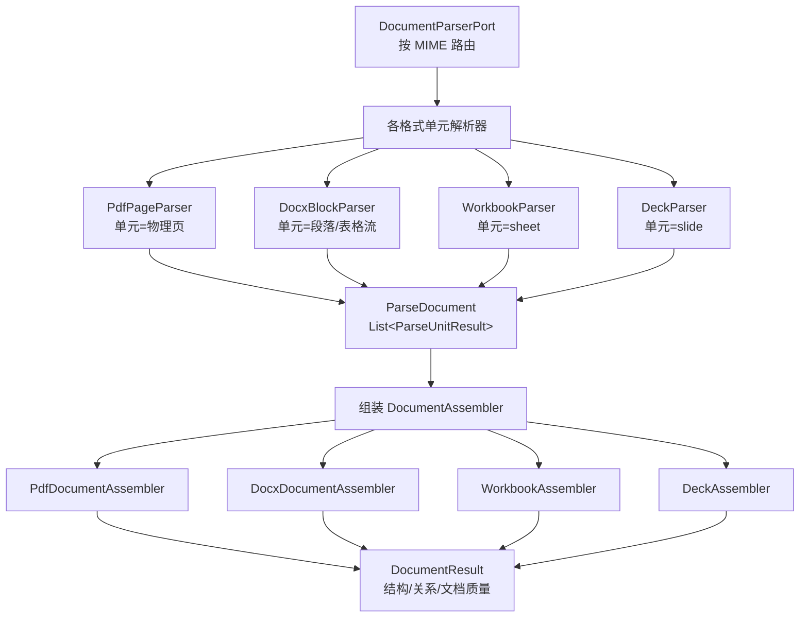
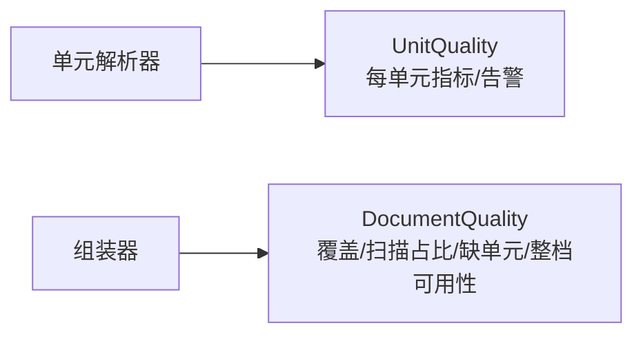

# 解析环节统一重构：设计（单元级解析 + 文档级组装）

> 本文件回答：解析环节**怎么改**——目标契约、各格式处理器映射、组装接口、质量分层与迁移方案。
> 范围：与 `10-解析环节统一重构-需求.md` 一致。
> 本文是实施方案；是否动手、改动顺序以本文与用户确认后的口径为准。
> 前提：需求已定为「解析只做单元内，组装做跨单元/文档级」。

**阅读指引**：要评审契约读第 2、3、4 节；要看迁移顺序读第 6 节；要看风险读第 8 节。

---

## 0. 先说结论

1. **改的是契约和边界，不是推倒重来。** 现有 `DocumentParserPort` 路由、`ParsePipeline` 骨架、STRUCTURE 阶段的组装能力都保留。
2. **解析产出从「扁平 `ParseSource`」改成「单元集合」**：每个单元独立、自包含、可序列化。
3. **文档级动作统一下沉到组装**：页眉页脚、跨页表、标题层级、跨页阅读顺序、文档质量。
4. **「页」必须抽象成「单元」**：PDF 用物理页，Excel 用 sheet，PPT 用 slide，Word 用段落/表格流（虚拟页只做质量口径）。
5. **组装器按格式实现，契约统一**：换解析器不改变组装消费的契约。
6. **分阶段迁移**：先统一契约和结果模型，再逐格式把文档级动作从解析里移出，每步用黄金对拍兜底。

---

## 1. 目标架构



---

## 2. 结果模型（契约）

### 2.1 单元集合

```java
public final class ParseDocument {
    private final UnitType unitType;          // PAGE / SLIDE / SHEET / BLOCK_STREAM
    private final List<ParseUnitResult> units;
    private final DocumentMeta meta;          // fileId、mimeType、provider、单元数
}
```

```java
public final class ParseUnitResult {
    private final int unitIndex;              // 页号 / slide 号 / sheet 号
    private final UnitType type;
    private final List<ParseElement> elements;
    private final UnitGeometry geometry;      // 按格式：bbox+旋转 / sheet 行列范围 / slide 尺寸 / 空
    private final UnitQuality quality;        // 本单元质量
}
```

约束：

- `ParseElement` 继续复用现有字段（`bbox`/`font`/`confidence`/`cells`/`provenance` 等），但单元归属由 `unitIndex` 表达，不再只靠元素上的 `page` 字段。
- `UnitGeometry` 按格式可选：PDF 有页面尺寸/旋转，Excel 有 sheet 行列范围，PPT 有 slide 尺寸，DOCX 无物理几何可为空。
- `UnitQuality` 复用现有 `PageMetric` 的字段口径，但命名对齐「单元」而非「页」。

### 2.2 单元类型枚举

```java
public enum UnitType {
    PAGE,         // PDF / 图片
    SLIDE,        // PPTX / PPT
    SHEET,        // XLSX / XLS
    BLOCK_STREAM  // DOCX / DOC：段落/表格流，不按物理页
}
```

> Word 的物理页由排版引擎决定，POI 读不到；`BLOCK_STREAM` 表示「不承诺物理页」。若下游质量口径需要虚拟页，仍可用 `office-page-chars` 折算，但那只是质量口径，不是单元边界。

### 2.3 文档元数据

```java
public final class DocumentMeta {
    private final String fileId;
    private final String mimeType;
    private final String provider;   // pdfbox-3.0.4 / poi-5.4.0
    private final UnitType unitType;
    private final int unitCount;
}
```

---

## 3. 各格式处理器映射

| 格式        | 单元        | 单元内产出                                                | 交给组装做的事                                             |
|-------------|-------------|-----------------------------------------------------------|------------------------------------------------------------|
| PDF         | 物理页      | 行/词/块、表格片段、图片、bbox、字体、页尺寸/旋转、页质量 | 页眉页脚识别、跨页表合并、跨页阅读顺序、标题层级、文档质量 |
| DOCX        | 段落/表格流 | 段落、表格、图片、样式/字体、页眉页脚部件原始内容         | 页眉页脚部件分类、章节/标题、关系、文档质量                |
| DOC         | 段落/表格流 | 同上（HWPF 表格无合并信息）                               | 同上                                                       |
| XLSX/XLS    | 工作表      | sheet 表格、单元格/合并/公式、图片                        | 工作簿结构、sheet 关系、文档质量                           |
| PPTX/PPT    | 幻灯片      | slide 文本/表格/图片、slide 质量                          | 演示文稿结构、slide 顺序、文档质量                         |
| 图片/扫描件 | 图片/物理页 | OCR 文本、bbox、页质量                                    | 多页合并、文档质量                                         |

关键：**只有 PDF 需要「跨页表格合并」**。DOCX 的表格本来就是一个 XML 表格，分页是渲染结果；XLSX/PPTX 也没有跨页表格概念。

---

## 4. 组装接口

### 4.1 契约

```java
public interface DocumentAssembler {
    UnitType supports();
    DocumentResult assemble(ParseDocument document, AssembleContext context);
}
```

每格式一个实现：

| 实现                    | 职责                                                       |
|-------------------------|------------------------------------------------------------|
| `PdfDocumentAssembler`  | 页眉页脚识别、跨页表合并、跨页阅读顺序、标题层级、文档质量 |
| `DocxDocumentAssembler` | 页眉页脚部件分类、章节/标题、元素关系                      |
| `WorkbookAssembler`     | 工作簿结构、sheet 关系                                     |
| `DeckAssembler`         | 演示文稿结构、slide 顺序                                   |

### 4.2 与现有 STRUCTURE 的关系

现有 `AssemblerPipeline` 已经承担了大部分文档级工作：

- `TableContinuationResolverImpl` 已做跨页表合并；
- `ReadingOrderResolverImpl` 已做全档阅读顺序、排除 HEADER/FOOTER；
- `StructureAssemblerImpl` 已做章节树；
- `RepeatNoiseMarkerImpl` 已做重复/噪声识别。

重构的核心是把「解析里已经做的文档级动作」移过去，而不是新建一套组装：

| 解析里现在做的事                             | 去向                                                                                                   |
|----------------------------------------------|--------------------------------------------------------------------------------------------------------|
| `HeaderFooterStep`（跨页识别页眉页脚键）     | 移到组装；`HeaderFooterDetector` 归入文档分析/组装                                                     |
| `TableContinuationStep`（跨页续表标记）      | 已删除（落地）；标记与接续判定同归组装 `TableContinuationResolverImpl`（先标续页重复表头，再接续合并） |
| Office `parseNative` 里的页眉页脚产出        | 改为产出原始部件/普通元素；组装分类                                                                    |
| Office `fillVirtualPageMetrics` 的文档级口径 | 移到质量环节；单元级指标仍留在解析                                                                     |

---

## 5. 质量分层



- **解析产出 `UnitQuality`**：字符数、乱码率、空单元、图片占比、置信度、本单元告警；
- **组装/质量阶段产出 `DocumentQuality`**：单元覆盖、扫描单元占比、缺单元、跨单元一致性、整档是否可用；
- **文档级门禁（SUCCESS/PARTIAL/FAILED）的去留**为开放问题，见需求文档第 7 节。

---

## 6. 迁移方案（分阶段）

| 阶段 | 动作                                                                                                                    | 验收                                          | 风险 |
|------|-------------------------------------------------------------------------------------------------------------------------|-----------------------------------------------|------|
| M1   | 定义 `ParseDocument` / `ParseUnitResult` / `UnitType` / `UnitQuality` 契约与代码骨架；保留旧 `ParseSource` 作为兼容适配 | 新契约可序列化；单测通过                      | 低   |
| M2   | 结果组装：各解析器改为产单元集合，再由适配层汇总成旧 `ParseSource`，保证下游暂不感知                                    | 黄金对拍：元素/指标一致                       | 低   |
| M3   | PDF：`HeaderFooterStep`、`TableContinuationStep` 移出解析，组装接管；`HeaderFooterDetector` 迁到组装侧                  | PDF 元素一致，页眉页脚/跨页表结论改由组装产出 | 中   |
| M4   | Office：DOCX/DOC 页眉页脚部件改原始输出；虚拟页口径移到质量环节；单元按 sheet/slide/block-stream 组织                   | 黄金对拍；组装消费新契约                      | 中   |
| M5   | 组装器契约 `DocumentAssembler` 落地，替换旧 `AssemblerPipeline` 的消费入口                                              | 组装产物 `UnifiedDocument` 不变               | 中   |
| M6   | 删除旧 `ParseSource` 扁平路径；文档级质量归位                                                                           | 全量测试 + 门禁                               | 中高 |

原则：

- 每个阶段独立提交，黄金对拍不为零就回滚该阶段；
- 不改算法、阈值、元素顺序、ID、溯源、事实顺序——只改「哪层做、结果怎么组织」；
- 先契约后实现，先 PDF 后 Office。

实施进度：

- **M1、M2 已落地（PDF）**：新增 `ParseUnitResult` / `ParseDocument` / `UnitType` / `UnitLine`；PDF 流水线按物理页产出单元（元素、行摘要、单元指标、页尺寸），`ParseSource.fromDocument` 派生文档级汇总视图；`PdfParseGoldenTest` 快照零差异。
- **M3 的跨页续表部分已落地**：解析删除跨页续表步骤与 `ParseElement.headerRepeated` 字段，标记与合并同归组装 `TableContinuationResolverImpl`（先标续页重复表头，再按四条件接续）；阈值从解析配置迁到 `knowledge.structure.continuation-overlap-ratio`；PDF 黄金快照零差异。
- **待办**：页眉页脚下移与 M4–M6 未开始。页眉页脚不能只按「带内几何」抽出候选行——正文/表头落在页顶带内会被拆出正文流（黄金样本实测段落裂开），故须等组装直接消费 `ParseUnitResult.lines` 后再迁移。

---

## 7. 兼容与回滚

1. `ParseSource` 先保留为「文档级汇总视图」，由单元集合实时汇总或适配器生成；下游（组装、预处理）不感知新契约。
2. 每个处理器在切到新契约前，都保留「旧输出」路径；黄金对拍能证明等价才切。
3. 文档级动作（页眉页脚、跨页表）在解析与组装都跑一份做对拍，验证结论一致后再删解析里的那份。

---

## 8. 风险与边界

| 风险                       | 说明                                                                      | 缓解                                                     |
|----------------------------|---------------------------------------------------------------------------|----------------------------------------------------------|
| 页眉页脚下移导致组装复杂化 | 组装要重新识别，且依赖解析给足位置/字体信息                               | 复用 `HeaderFooterDetector`；黄金对拍                    |
| 跨页表合并下移             | 解析不再给 `cutAtPageBottom`/`headerRepeated` 标记，组装要从几何/表头推断 | 组装已有 `TableContinuationResolverImpl`；用真实样本验证 |
| DOCX 无物理页              | 不能强行按页切分；下游可能依赖 `page` 字段                                | 明确 `BLOCK_STREAM`；虚拟页只做质量口径                  |
| 文档级质量门禁去留         | 解析任务需要成功/失败结论，但门禁是文档级                                 | 列为开放问题，先不移动，避免打断任务模型                 |
| 契约放大                   | 单元结果 schema 变重，序列化体积上升                                      | 只携带组装必需的字段；分单元存储                         |

明确不做：

- 不改组装阶段的算法细节（标题规则、阅读顺序实现）——那是 `03-组装与预处理.md` 的范围；
- 不接 OCR/版面/表格模型能力；
- 不在本阶段把 DOCX 强行按物理页解析（需排版引擎，属 D2）。

---

## 9. 验收

| 层级 | 用例                                              | 验证点                                     |
|------|---------------------------------------------------|--------------------------------------------|
| 单元 | 单元结果序列化/反序列化                           | 不泄漏解析器句柄                           |
| 单元 | 每个处理器产单元集合                              | 单元数、单元类型、元素归属正确             |
| 集成 | PDF 页眉页脚/跨页表由组装产出                     | 解析不产 HEADER/FOOTER 标签与续表标记      |
| 集成 | Office 页眉页脚部件原始输出                       | 组装分类后结论与现状一致                   |
| 回归 | `mvn -o -pl workbuddy-worker -am test` + biz 定向 | 现有用例不回归                             |
| 对拍 | 黄金文档集                                        | 改造前后元素/指标/质量结论等价或差异已登记 |

---

## 10. 证据索引

- 解析编排：`workbuddy-server/workbuddy-worker/src/main/java/com/workbuddy/worker/parser/ParsePipeline.java`
- PDF 流水线：`workbuddy-server/workbuddy-worker/src/main/java/com/workbuddy/worker/parser/pdf/pipeline/PdfDocumentPipeline.java`
- PDF 页眉页脚检测：`workbuddy-server/workbuddy-worker/src/main/java/com/workbuddy/worker/parser/pdf/detect/HeaderFooterDetector.java`
- 跨页续表标记与合并：`workbuddy-server/workbuddy-worker/src/main/java/com/workbuddy/worker/structure/impl/craft/TableContinuationResolverImpl.java`
- Office 基类：`workbuddy-server/workbuddy-worker/src/main/java/com/workbuddy/worker/parser/office/AbstractPoiDocumentParser.java`
- 组装编排：`workbuddy-server/workbuddy-worker/src/main/java/com/workbuddy/worker/structure/impl/AssemblerPipeline.java`
- 组装续表合并：`workbuddy-server/workbuddy-worker/src/main/java/com/workbuddy/worker/structure/impl/craft/TableContinuationResolverImpl.java`
- 组装阅读顺序：`workbuddy-server/workbuddy-worker/src/main/java/com/workbuddy/worker/structure/impl/craft/ReadingOrderResolverImpl.java`
- 组装章节树：`workbuddy-server/workbuddy-worker/src/main/java/com/workbuddy/worker/structure/impl/craft/StructureAssemblerImpl.java`
- 组装重复/噪声：`workbuddy-server/workbuddy-worker/src/main/java/com/workbuddy/worker/structure/impl/craft/RepeatNoiseMarkerImpl.java`
- 结果来源：`workbuddy-server/workbuddy-common/src/main/java/com/workbuddy/common/domain/parse/ParseSource.java`
- 元素契约：`workbuddy-server/workbuddy-common/src/main/java/com/workbuddy/common/domain/parse/ParseElement.java`
